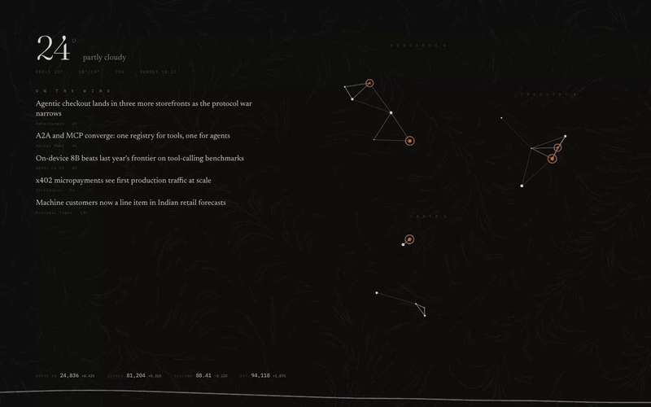
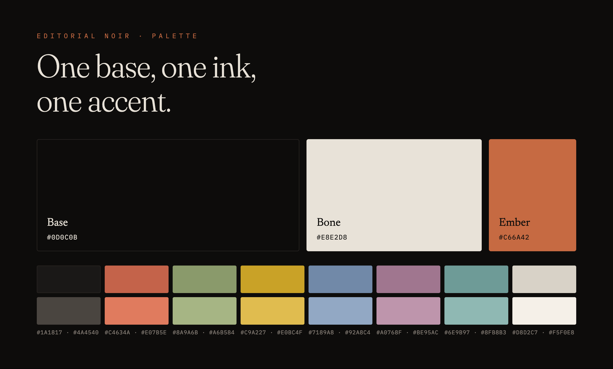
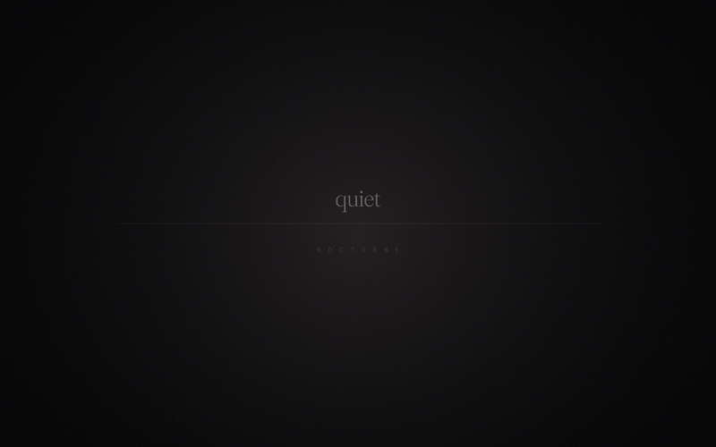
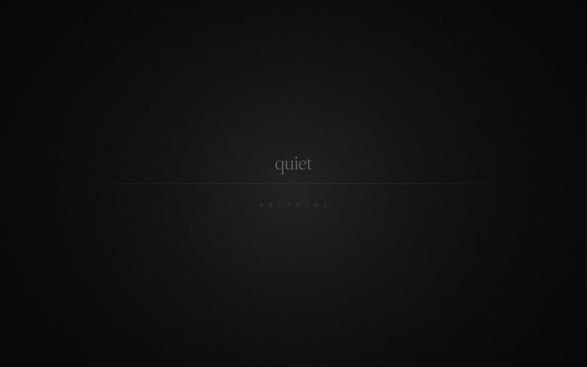
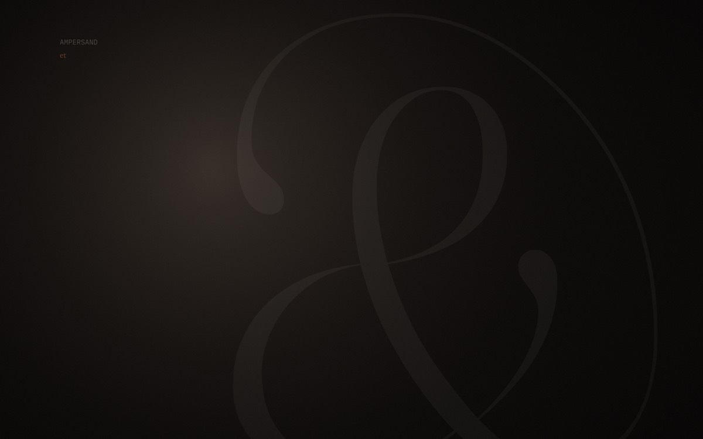
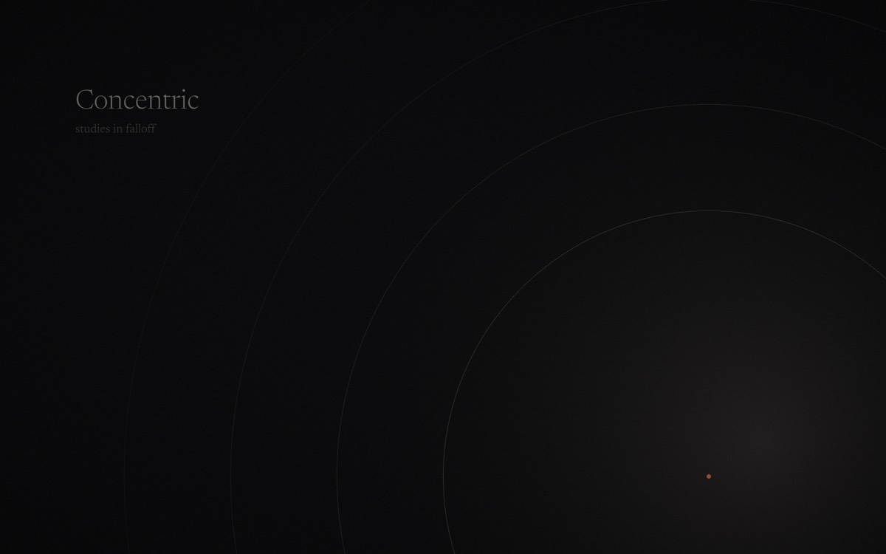
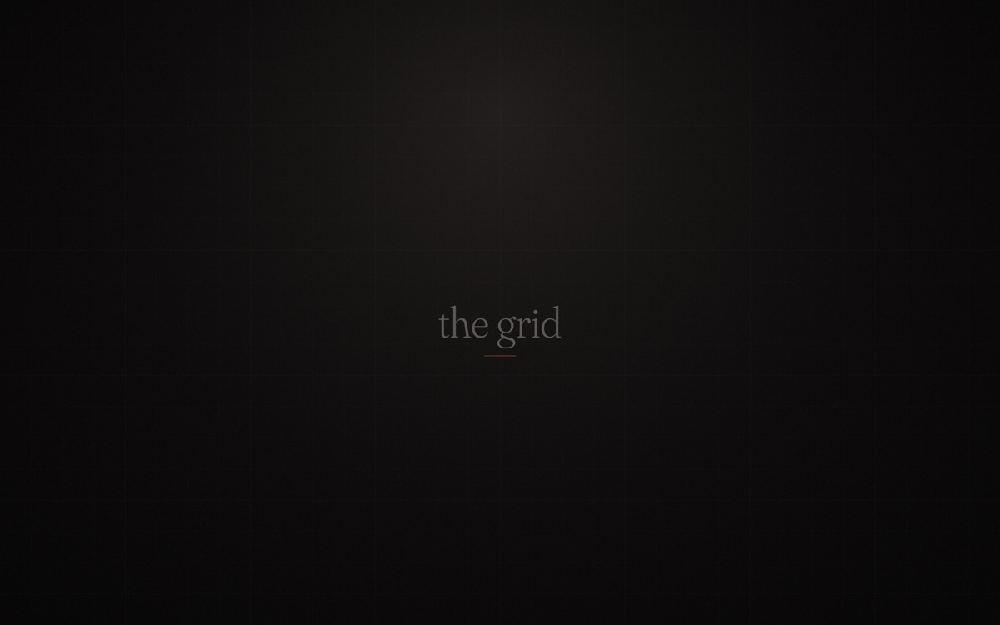
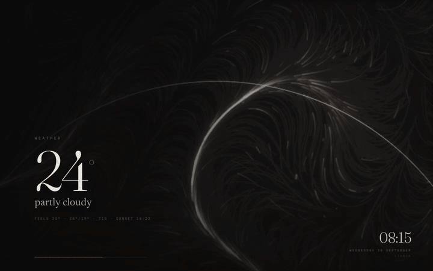
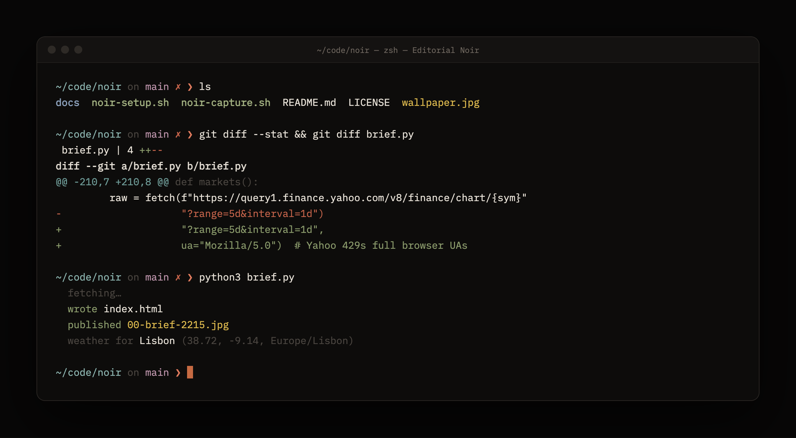

<h1 align="center">Cinematic Noir</h1>

<p align="center">
  <em>A warm near-black theme for macOS — wallpapers, system appearance, Terminal,<br>
  a live headline brief and an animated screen saver. One script.</em>
</p>

<p align="center">
  
</p>

<p align="center">
  
</p>

The theme is called **Editorial Noir** inside macOS. Everything sits on one
base, `#0D0C0B` (a charcoal with a little red in it rather than a flat
neutral), with bone-white ink `#E8E2D8` and a single ember accent `#C66A42`,
used sparingly.

---

## The look

### Wallpapers

<p align="center">
  
</p>

| | |
|:---:|:---:|
|  |  |
| **Rule** · one fading hairline, nothing competes with your windows | **Ligature** · an oversized Fraunces ampersand at ~4% opacity |
|  |  |
| **Arc** · concentric hairlines falling off to the corner | **Grid** · a faint engineering grid with a serif mark |

Six in all, 3840 × 2400, rendered on your Mac rather than downloaded. Each one
carries fine film grain on purpose: it dithers the gradients so they don't
band on a dark panel. The seed is fixed, so every Mac gets identical files.
(Colophon, the sixth, carries a small imprint line with your city on it.)

### Screen saver

<p align="center">
  
</p>

**NoirSaver** is a real screen saver, not a slideshow: one headline at a time
in Fraunces, over drifting light, with a live clock and date. Cards change
every 7 seconds.

### Terminal

<p align="center">
  
</p>

A matching Terminal.app profile. The 16 ANSI colours are tuned so `ls`,
`git diff` and syntax highlighting stay legible without any one hue shouting
over the others. Ember is kept for the cursor.

### The rest of the Mac

- **Dark mode**, pinned rather than Auto, with a **graphite** accent, so the
  only colour on screen is what you put there.
- **Dock** without recent apps. **Bottom-left hot corner** starts the screen
  saver. Screen saver after **5 minutes**.
- **Menu-bar brief**: a small dot that lists the headlines, grouped and
  deduped, and opens the full page in a window. Your desktop stays your
  wallpaper — a wallpaper is covered when you work and visible when you're
  not reading, so it's the wrong place for headlines.

Type throughout: **Fraunces** (display), **Newsreader** (text),
**IBM Plex Mono** (mono).

---

## Install

```sh
git clone https://github.com/iprajax/cinematic-noir-theme.git
cd cinematic-noir-theme
bash noir-setup.sh
```

Or double-click **Set Up This Mac.command**. It takes a few minutes, most of
it rendering wallpapers. Everything lands in `~/Pictures/Editorial Noir`.

**Needs:** macOS 26 on Apple Silicon (the only setup it's tested on), and
the Command Line Tools (`xcode-select --install`) for `python3` and `swiftc`.
No `sudo`, no API keys, no third-party apps. The first run fetches the fonts
from Google Fonts and `pillow`/`numpy` into a throwaway virtualenv.

**Then two clicks** — macOS keeps these where scripts shouldn't write, and
setup reminds you at the end:

1. System Settings ▸ Screen Saver ▸ Other ▸ **NoirSaver**.
2. Log out and back in once, so the accent reaches every app. Quit and
   reopen Terminal (⌘Q) for the profile.

## Make it yours

Copy `noir.local.example.sh` to `noir.local.sh` (git-ignored). Every line is
optional:

```sh
NOIR_CITY="Lisbon"          # weather location for the brief
NOIR_LAT="38.7223"
NOIR_LON="-9.1393"
NOIR_TZ="Europe/Lisbon"
NOIR_IMPRINT="LISBON"       # the imprint line on the Colophon wallpaper
```

Left unset, the location comes from your Mac's time zone via the system zone
table (`/usr/share/zoneinfo/zone.tab`), with no network lookup. A time zone's
reference city isn't always yours (`Asia/Kolkata` gives Kolkata), so set the
coordinates if it matters.

**What the brief reads** is plain lists at the top of the builder in
`noir-brief-install.sh`. Edit, then re-run it:

- `FEEDS` — four groups of RSS/Atom feeds: research, industry, India, commerce.
- `WATCH`, `WATCH_SOURCES` — keywords and sources that promote a headline to the top.
- `MARKETS` — the quote strip. NIFTY 50, SENSEX, USD/INR and BTC by default.

### Take your tweaks to another Mac

The preset is a starting point. If you've since changed your Dock size, hot
corners, highlight colour or wallpaper:

```sh
bash noir-capture.sh        # writes my-settings.sh (git-ignored)
```

`my-settings.sh` is a readable list of `defaults write` / `defaults delete`
lines. Bring it along with the repo. `noir-setup.sh` applies it on top of the
preset, so your changes win, and settings you never set are removed on the
other Mac, so the two actually match.

---

## Under the hood

```
noir-setup.sh            the whole thing, in order ─┐
 ├─ noir-capture.sh --out .before-setup-….sh         │ 1. back up this Mac's settings (undo file)
 ├─ editorial-noir.sh                                │ 2. wallpapers, Terminal profile, appearance
 ├─ my-settings.sh   (optional)                      │ 3. your snapshot, layered on top
 └─ noir-brief-install.sh                            │ 4. the brief, NoirWall, NoirSaver
```

| File | What it does |
|---|---|
| `editorial-noir.sh` | Renders the six wallpapers with Pillow + NumPy in a throwaway venv, writes the Terminal profile (NSKeyedArchiver colour blobs, which is why it's Python), sets Dark mode, accent, wallpaper, Dock and hot corner. Backs up what it changes to `.defaults-backup.txt`. |
| `noir-brief-install.sh` | Writes `brief.py` (standard-library Python: RSS/Atom, Open-Meteo weather, Yahoo quotes) and the HTML pages it renders. Compiles two small Swift programs — **NoirWall** (a menu-bar app with a `WKWebView`) and **NoirSaver** (a `ScreenSaverView` bundle). Schedules a rebuild every 15 minutes with `launchd`. |
| `noir-capture.sh` | Reads an allowlist of appearance keys with `defaults read-type` and writes them back out as replayable lines, typed correctly. Unset keys become deletes. |
| `noir-setup.sh` | Runs the three above in order and prints what's left to click. |
| `noir.local.example.sh` | Template for your personal settings. |

**Where things live after install**

| Path | |
|---|---|
| `~/Pictures/Editorial Noir/` | wallpapers, Terminal profile, the brief |
| `~/Pictures/Editorial Noir/brief/` | `brief.py`, `config.json`, pages, `brief.log`, `wall.log` |
| `~/Applications/NoirWall.app` | the menu-bar brief |
| `~/Library/Screen Savers/NoirSaver.saver` | the screen saver |
| `~/Library/LaunchAgents/com.editorialnoir.noir{brief,wall}.plist` | the schedule and the menu-bar app at login |

Handy commands:

```sh
python3 ~/Pictures/"Editorial Noir"/brief/brief.py          # rebuild now
python3 ~/Pictures/"Editorial Noir"/brief/brief.py --mock   # preview with sample data, no network
```

### Undo and uninstall

Setup saves the settings it's about to change. Put them back with:

```sh
bash ~/Pictures/"Editorial Noir"/.before-setup-*.sh
```

Remove the brief, NoirWall and NoirSaver:

```sh
launchctl bootout gui/$(id -u)/com.editorialnoir.noirbrief
launchctl bootout gui/$(id -u)/com.editorialnoir.noirwall
rm -rf ~/Pictures/"Editorial Noir"/brief ~/Applications/NoirWall.app \
       ~/Library/"Screen Savers"/NoirSaver.saver \
       ~/Library/LaunchAgents/com.editorialnoir.noir{brief,wall}.plist \
       ~/Library/Application\ Support/"Noir Brief"
```

### Notes

- Market quotes use Yahoo Finance's public chart endpoint. It's unofficial,
  undocumented, rate-limited and can change without notice. When it fails the
  brief simply drops the quote strip; `brief.log` will show
  `skipped query1.finance.yahoo.com`.
- Headlines come straight from each publisher's feed, and nothing is stored
  beyond a local cache. The only thing about you that goes anywhere is your
  coordinates, sent to [Open-Meteo](https://open-meteo.com) for the forecast.
- The GIFs above were recorded from the real pages, rendered with the
  `--mock` sample data.

## License

[MIT](LICENSE).

The fonts — [Fraunces](https://github.com/undercasetype/Fraunces),
[Newsreader](https://github.com/productiontype/Newsreader) and
[IBM Plex Mono](https://github.com/IBM/plex) — are downloaded at install time
from [Google Fonts](https://github.com/google/fonts) under the
[SIL Open Font License 1.1](https://openfontlicense.org). They are not
redistributed here.
